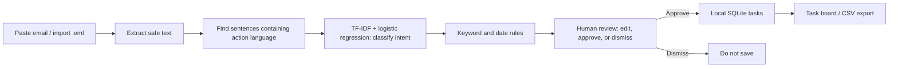
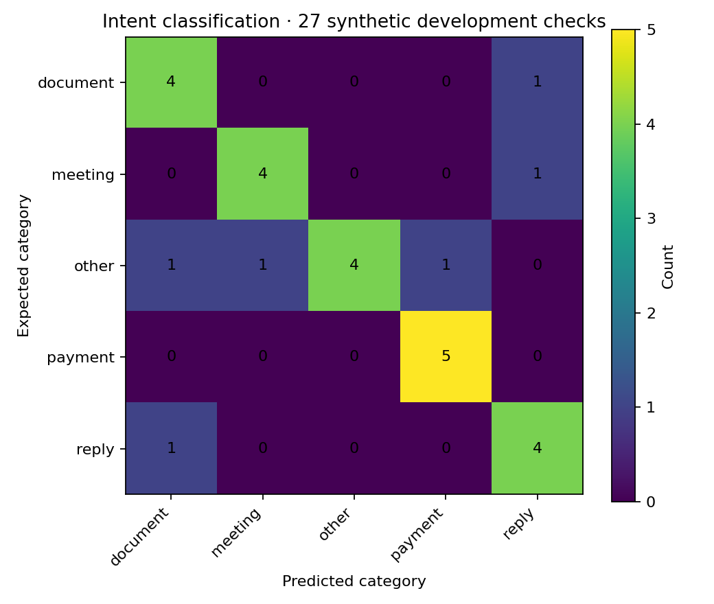

# ActionInbox

### Turn the emails you meant to act on into a task list you actually use.

**An offline-first, review-before-saving email-to-task app.** Built with React, FastAPI, SQLite, and a small local scikit-learn model. No mailbox permissions, GPU, or paid AI API required.

[](https://github.com/charithreddy9/ActionInbox/actions/workflows/ci.yml)

  

## Why this project

My inbox tends to mix two different kinds of information: things I should read, and things I actually need to do. The second kind is easy to lose between newsletters, receipts, and meeting updates. I wanted a tool that could make a first pass over a message, point to the exact sentence that matters, and let me decide whether it belongs on my task list.

**ActionInbox doesn't connect to Gmail, send emails, or silently create reminders.** You paste an email or import a small `.eml` file, review the suggestions, edit anything the model got wrong, and click **Approve task**. Only approved task details and their source excerpts go into the local SQLite database.

## What you can do

1. **Analyze a message:** Paste text or import `.eml` / `.txt`. You can try the fictional example included in the interface.
2. **Review every suggestion:** See the original supporting sentence, suggested category, possible due date, and a short explanation of the rule that fired.
3. **Correct before saving:** Change the title, due date, priority, or category—or dismiss the suggestion altogether.
4. **Work through your list:** Mark tasks complete, search and filter them, edit their details, and export approved tasks as a CSV.
5. **Inspect the model:** Open the ML Evaluation tab and explore both the passing and failing examples from the recorded synthetic development check.

**Example email**

> Please pay the internet bill by November 8. Could you upload the signed lease form by Friday?

The app suggests two tasks, each with its own quoted source sentence and detected date. It does not save either one until you approve it. For ambiguous dates (including “next Friday”) the suggested interpretation should be reviewed before saving.

## The interesting part: a small, testable NLP pipeline



I deliberately kept the model small and inspectable. The TF-IDF / logistic regression pipeline is trained on **60 fictional labeled sentences** across five categories: payment, meeting, document, reply, and other. Keyword rules provide additional signals. Date extraction uses explicit date formats and a small set of relative expressions like “tomorrow” or “Friday.” Dates that are absent aren't invented.

This is not a language model, so there's no API key, generated reasoning, or hidden call to a hosted model. The classification score shown in code is **not calibrated confidence** in the correctness of a task.

## Getting started

Requires **Python 3.11+** and **Node.js 22+**. From the repository root:

```bash
python -m venv .venv
source .venv/bin/activate  # Windows PowerShell: .venv\Scripts\Activate.ps1
pip install -r requirements-dev.txt
python -m uvicorn backend.app:app --host 127.0.0.1 --port 8000
```

In another terminal:

```bash
cd frontend
npm install
npm run dev
```

Open **http://127.0.0.1:5173**. The Vite dev server proxies `/api` to FastAPI. You do **not** need to configure a database: the first approved task creates a local `data/tasks.sqlite3` file, which is ignored by Git.

To generate the evaluation report and run tests:

```bash
python -m pytest -q
python -m backend.evaluate
cd frontend && npm run build
```

The included GitHub Actions workflow runs backend tests, generates the evaluation report, and builds the frontend.

## Actual evaluation, including mistakes

The training set is small and synthetic. I made a separate **27-sentence author-written development check**, including harder wording and some misleading non-action statements. On that set the intent-classification pipeline scored:

| Metric | Result |
|---|---:|
| Intent category accuracy | **77.8% (21/27)** |
| Intent macro-F1 | **0.778** |
| Examples with wrong categories | **6** |

Some mistakes are revealing. “Our invoice was paid in full” was predicted as a payment task even though it is informational. “Meet me to discuss the handoff” was assigned to the wrong category. The full case-level results, confusion matrix, and labels are in [`research/evaluation.json`](research/evaluation.json).



The model results above measure **intent categorization only**, not task-detection precision, extraction quality, date correctness, or a fully automated workflow. The evaluation questions were manually authored by the same project author and resemble the training domain. This is a regression check—not representative performance on real personal emails. The unit suite separately tests common date formats, deduplication, `.eml` parsing, quotation suppression, and approval behavior.

See [Research notes](research/RESEARCH.md) for the failure analysis and next experiment.

## Privacy and current limitations

- This is a **local-first prototype**, not a public SaaS. Run the backend bound to `127.0.0.1`. There is **no login/authentication**, so don't expose it on a public server or shared network.
- Email messages are analyzed in-process. The raw pasted message isn't stored by the backend; approved task title, source excerpt, subject, category, due date, and a hash are saved to local SQLite. The browser keeps the pasted message in memory until you navigate/reload.
- `.eml` import handles text/plain or simple text/html email bodies. It does **not** scan attachments, validate sender authenticity, decrypt messages, or handle every email client variation.
- Relative date language can be ambiguous; timezone and meeting-hour extraction are not implemented. The app displays a date suggestion for review, not a guaranteed appointment.
- This app does **not** access inboxes automatically, send notifications, write to calendars, or execute instructions embedded in emails. That would require a more secure authentication and permissions design.
- The ML model and action-detector can produce false positives and false negatives. The human approval step is intentional, not just a UI detail.

## Next experiments I'd try

I'd start by measuring **end-to-end action extraction** on a larger independently labeled email dataset, not by adding a larger model. After that: improve false-positive filtering for informational emails, measure date extraction accuracy separately, and compare local small language models against the simple classifier **only if** they clearly improve reliability and latency. For daily use, reminders and calendar export would be reasonable next features once the basics are tested.

---

**Tech:** Python · FastAPI · scikit-learn · dateutil · SQLite · React · Vite · pytest · GitHub Actions

*I built this as a practical AI/ML engineering project: a useful interface, an explainable baseline, real failure cases, automated tests, and privacy choices that matter.*