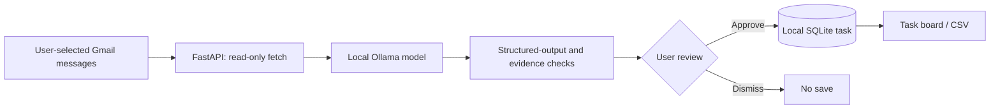

# ActionInbox

**Local-first email intelligence: find actionable requests, organize deadlines, and review every task before saving.**

**Current development branch:** [`feature/llm-email-intelligence`](https://github.com/charithreddy9/ActionInbox/tree/feature/llm-email-intelligence) · [Stable baseline (`main`)](https://github.com/charithreddy9/ActionInbox/tree/main)

[](https://github.com/charithreddy9/ActionInbox/actions/workflows/ci.yml?query=branch%3Afeature%2Fllm-email-intelligence)

**Stack:** Python · FastAPI · Ollama / Qwen3 4B · scikit-learn · React / Vite · SQLite · Gmail API (read-only) · pytest · GitHub Actions

## The problem

Important emails compete with receipts, subscriptions, confirmations, marketing, and repeated reminders. A single email can contain several independent tasks; a later message can also cancel, complete, or change an earlier event.

I built ActionInbox to turn that information into reviewable actions without handing control of my inbox or to-do list to an automated agent. Gmail is **optional, read-only and explicitly user-triggered**. The app runs locally and does **not** send email, make purchases, modify calendars or automatically save tasks.

## v5: Model-driven email understanding (experimental)

The **Local AI** panel is a new path alongside the older rule-based Smart Inbox Radar. A user manually searches Gmail, selects **1–5 messages**, and requests analysis. The selected bodies are sent to an installed **local Ollama model** on the user's computer.

The language model is instructed to:
- Extract **zero, one, or multiple** independent actionable items from selected emails.
- Infer semantic **task categories**, rather than choosing from provider-name or keyword rules.
- Suggest deadlines, priorities, event lifecycle status, and supporting evidence.
- Consider whether multiple **selected messages** describe the same underlying event.
- Distinguish potential obligations from advertisements, confirmations, and completed actions.

The server validates the model's JSON shape, source message IDs, ISO date syntax, and whether an evidence excerpt appears in the provided source text. **These checks do not prove semantic correctness**: users must verify the proposed action and date.

After analysis, suggested tasks appear in an **editable review step**. Only clicking **Approve task** stores an approved task in local SQLite. Approved tasks can be edited, completed, searched, or exported as CSV.

### Architecture



**Why this is a separate development branch:** The older keyword and TF-IDF pipelines remain available for comparison and regression testing. v5's model-driven path is still being validated on real model outputs. Existing CI tests cover application behavior using **mocked model responses**; a successful CI run is **not** proof of accurate extraction on live Gmail messages.

### Known limitations

- A real Ollama inference request has surfaced a **503** during local testing; improved diagnostics are committed, but the underlying runtime/model issue needs verification on the local machine.
- The first implementation analyzes up to **five explicitly selected messages** at once, not the entire inbox.
- Model grouping works on the currently selected batch and is not guaranteed across different selections.
- Quote checks verify that evidence text exists, **not** whether the inferred task and date are correct.
- Dates are currently represented as dates, not guaranteed timezone-aware appointment times.
- The schema caps output at 24 events per analysis. Bigger batches need explicit pagination/incomplete-output handling.
- The legacy rule-based Smart Inbox Radar is still available as a separate feature.
- Gmail account switching and account-scoped task tracking are **future milestones**.

Read [LOCAL_AI_V5.md](LOCAL_AI_V5.md) for the evolving local-AI setup and design notes.

## Earlier versions and lessons

**v1 — Explainable baseline.** A TF-IDF + logistic regression classifier trained on **60 fictional labeled sentences**, with transparent action and date rules. On an author-written 27-case **intent-category development check**, it scored **21/27 (77.8%)**, macro-F1 **0.778**. This measures category prediction on a small synthetic set — **not** real-email task extraction precision or model quality.

**v2 — Gmail read-only integration.** Local OAuth credentials, explicit email search and preview, no automatic Gmail modifications.

**v3/v4 — Deadline Radar.** User-triggered bounded scans for bills, subscriptions, trials, travel pickups, appointments and more, with regression cases for promotional false positives, duplicate notices and completed confirmations.

These versions made the shortcomings concrete: a billing advertisement can look like a payment reminder; an email's legal footer can be mistaken for a new action; and a failed pickup should supersede an earlier reminder. The new model-based approach is designed to address those failure modes, but still requires measurement.

## Run v5 locally (Windows)

Requirements: **Python 3.11+**, **Node.js 22+**, optional Gmail OAuth configuration, and [Ollama](https://ollama.com/download).

```powershell
git clone https://github.com/charithreddy9/ActionInbox.git
cd ActionInbox
git switch feature/llm-email-intelligence
py -3.11 -m venv .venv
.\.venv\Scripts\python.exe -m pip install -r requirements-dev.txt
ollama pull qwen3:4b
.\.venv\Scripts\python.exe -m uvicorn backend.app:app --host 127.0.0.1 --port 8000 --reload
```

In another PowerShell window:

```powershell
cd frontend
npm install
npm run dev
```

Open [http://127.0.0.1:5173](http://127.0.0.1:5173). For Gmail OAuth setup use [GMAIL_SETUP.md](GMAIL_SETUP.md). On the Gmail screen, search for messages, select up to five, then use **Local AI → Analyze selected emails**.

You can also test local AI on fictional pasted text using the API without connecting Gmail.

Run automated checks:

```powershell
.\.venv\Scripts\python.exe -m pytest -q
cd frontend
npm run build
```

To choose a different installed Ollama model, set the `ACTIONINBOX_OLLAMA_MODEL` environment variable before starting the backend. The model endpoint is local `127.0.0.1:11434`.

## Privacy and safety

This is a **localhost-only prototype**, not a public multi-user service. No application authentication is implemented; do not expose FastAPI or Ollama on a public interface. Keep `credentials.json`, `data/gmail-token.json` and the local SQLite database private. Gmail access is read-only, and model-derived instructions are **suggestions**, never actions the application executes automatically.

Full email bodies are processed locally on request but are not written into the tasks database. Approved tasks do store selected task details and supporting excerpts. The user must validate any deadline or financial implication against the actual email/provider.

## What I'd evaluate next

The next milestone is a **real-model benchmark** of emails with zero, one and multiple actions, misleading promotions, completed events, and contradictory updates. I want to measure actionable-task precision/recall, deadline association, unsupported suggestions, incorrect event merges, and local inference latency, alongside the existing regression suite.

**Build the system, test the assumptions, keep the failures visible.**
